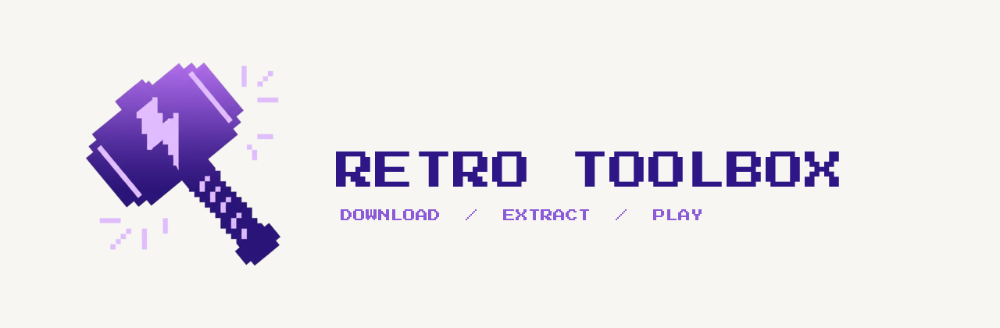
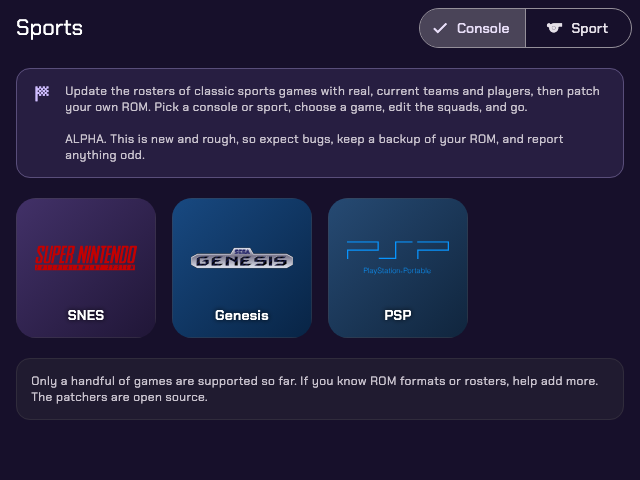
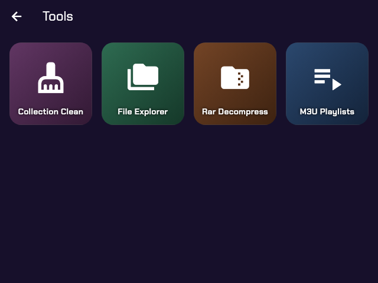

# Retro Toolbox

<div align="center">
  
  <p><a href="https://hiitsgabe.github.io/retro_toolbox/"><strong>Visit the website</strong></a> · <a href="https://github.com/hiitsgabe/retro_toolbox/releases/latest"><strong>Download</strong></a></p>
  <p><a href="https://github.com/hiitsgabe/retro_toolbox/actions/workflows/scan.yml"></a></p>
</div>

<br>

A toolbox for people who own retro consoles and handhelds. Retro Toolbox puts the jobs
that usually take a PC, a terminal and five different programs into one app:

- **Update classic sports games** with this season's real teams and players, then patch your own ROM.
- **Move files between your devices** over the local network: SMB, FTP, save sync with a Switch, installs to a 3DS.
- **Convert and tidy your game files**: CHD, M3U playlists, RAR/ZIP, NSZ, 3DS to CIA, duplicate and junk cleanup.
- **Run it on the handheld itself**: an ARM64 Linux build for PortMaster, fully driven by the gamepad.

It runs on Android, macOS, Windows, Linux and ARM64 Linux handhelds (Knulli, muOS, ROCKNIX and
other PortMaster firmwares).

---

## Sports roster patcher (alpha)

Old sports games are stuck with the rosters of the year they shipped. The **Sports** menu fetches
current teams and players, lets you edit them, and writes them into a ROM or disc image you already
own. It runs on the [`retro_roster_patcher`](https://github.com/hiitsgabe/retro_roster_patcher)
library inside the app; no terminal, no Python install.

| Game | Console | Sport |
| --- | --- | --- |
| International Superstar Soccer | SNES | Soccer |
| International Superstar Soccer 2000 | N64 | Soccer |
| International Superstar Soccer Deluxe | SNES | Soccer |
| Ken Griffey Jr. Presents MLB | SNES | Baseball |
| NHL 94 | SNES | Hockey |
| NHL 94 | Genesis | Hockey |
| NBA Live 95 | Genesis | Basketball |
| NHL 07 | PSP | Hockey |
| MVP Baseball | PSP | Baseball |
| Winning Eleven 2002 | PS1 | Soccer |
| NHL 2005 | PS2 | Hockey |
| PES 2013 | PS2 | Soccer |

PS1 and PS2 games are hidden on handhelds: their disc images need more memory than those devices have.

How it works:

- **ROM:** the wizard looks for the game on your device first, or you pick the file. Zipped ROMs and
  multi-track `.cue`/`.bin` discs go in and come out the same way.
- **Season and league:** pick a season and, for soccer, a league. PES 2013 takes several leagues in
  one patch and can update the national teams too; ISS 2000 and ISS Deluxe put the clubs in their national-team
  slots and can fill the slots they leave with today's national squads; ISS Deluxe groups the clubs on
  team select's first pages under the league's name. You can add any ESPN league yourself (see below).
- **Teams:** reorder teams into the game's slots, add or remove them, and edit each squad: starters,
  bench, names, numbers, positions, stats and team colours, with player photos and club crests.
- **Look** (on the games that support it, such as Winning Eleven 2002, PES 2013, ISS, ISS Deluxe, ISS 2000, NHL 2005 and NHL 07):
  draw each team's logo into the game, blank the slots the league does not fill, and replace the
  title, menu and boot screens with branded art or your own PNG. Template ZIPs show exactly which
  part of each screen the game displays.
- **Kits** (Winning Eleven 2002, PES 2013, ISS, ISS Deluxe, ISS 2000): every club starts in its real home and
  away kit. Change the pattern and colours, reuse one of the game's own designs, or load your own
  PNG (a kit template is one tap away). ISS 2000 takes colours only: shirt, secondary, shorts and
  socks, with a preview, while the shirt keeps its slot's own design.
- **Patch:** choose where to save and the menu language where the game offers one (Winning
  Eleven 2002 menus come out of Japanese), then write the patched file.

Keep a backup of your original ROM: this is alpha software.

### Add your own leagues

Import a JSON file from the league step ("Add your own leagues"). Each entry needs an ESPN league code:

```json
[
  { "id": 9001, "code": "eng.2", "name": "Championship", "country": "England" }
]
```

- `id`: any number not used by a built-in league (use 9000+).
- `code`: the ESPN league code (for example `eng.2`, `bra.2`, `conmebol.sudamericana`).
- `name` / `country`: shown in the picker.

Imported leagues are stored in `sports_custom_leagues.json` in the app's support directory.

---

## Servers: move files over your network

Both devices just need to be on the same network.

- **SMB Share:** connect to a Samba/Windows share, browse it, download files or whole folders (optionally zipped), and upload to it.
- **FTP:** an FTP client for the same jobs, plus a built-in FTP server that shares a folder from this device.
- **Retro Tools Server:** share folders on this device over HTTP. Open them from a browser, or add them to another device's Games Library to browse with box art and download (downloads resume).
- **JDKV Server:** a WebDAV server for JKSV on a Switch. Back up and restore saves in both directions, straight from emulator save exports; the current save is backed up before any replace.
- **FBI Server:** install `.cia` and `.3ds` files onto a 3DS running FBI over the network, converting `.3ds` to `.cia` when needed.

Servers advertise the local address you pick in Settings, and each port can be changed under Advanced.

## Tools: convert and tidy your files

- **File Explorer:** browse internal storage, SD cards and Downloads; copy, move, zip, extract, rename, create folders and delete. Long jobs run in the background.
- **Collection Clean:** remove duplicate ROMs (keeps the largest), strip region and version tags from file names, and delete OS junk files. Every change is previewed first.
- **M3U Playlists:** find multi-disc games in a folder and write `.m3u` playlists, so emulators show one entry and swap discs in-game.
- **CHD Converter:** compress `.cue`/`.gdi`/`.iso` disc images to CHD to save space, or extract CHD back. `chdman` is bundled.
- **Rar Decompress:** extract `.rar` and `.zip` archives to a folder (RAR on Android, macOS and Linux, including handhelds).
- **NSZ Decompress:** turn Switch `.nsz` files back into installable `.nsp`. Needs your own `prod.keys`.
- **3DS to CIA:** convert `.3ds`/`.cci` dumps to installable `.cia` on the device. Encrypted dumps need your own `boot9.bin`.
- **Steam Shortcuts:** search the Steam store and write `.steam` shortcut files for launchers that run Steam games through GameHub or similar.

## On a handheld

The Linux handheld build (ARM64, PortMaster) keeps everything that runs well on a small device:
Sports (SNES, Genesis, N64 and PSP games), SMB, FTP, Retro Tools Server, File Explorer, Collection Clean,
Rar Decompress and M3U Playlists. It adds two handheld-only tools:

- **Console Info:** device and firmware, storage, memory, battery, temperature, the network address
  to type into FTP or SMB, and a process list where non-critical processes can be ended.
- **Download from link:** paste a link, or scan the QR code with your phone and send the link from
  a page it opens. The download runs in the background, resumes on retry, and `.zip`/`.rar` files
  can be extracted in place.

Everywhere, the app works with a gamepad or d-pad: A/B to open and go back, X/Y for marks and
actions, Start and Select for the main action and the task list, L1/R1 to page, and an on-screen
keyboard on handhelds. **About** checks GitHub for a newer release and downloads and installs it (installs from
PortMaster's catalog update through PortMaster).

<p align="center">
  
  
</p>

---

## Games Library (optional)

Off by default; turn it on in **Settings > Games Library**. It browses game files from an HTTP or
HTTPS file index you provide (HTML directory listings, JSON APIs or Internet Archive items) and
downloads them in parallel, in the background, with automatic extraction, box art, search, region
filters and favorites. With it on, two extras appear: **New Catalog Source** (add one console from a
URL) and **Tinfoil Server** (lets Tinfoil on a Switch install from that library).

The app does not host or distribute any games. Point it only at sources you have the right to use,
and only download files you legally own.

Provide a catalog in either of these ways:

- **In the app:** Settings > *Catalog Source* > import a JSON file or load one from a URL.
- **At build time:** put your catalog at `assets/catalog/consoles.json` before building (git-ignored).

A fictional example is at [`docs/consoles.example.json`](docs/consoles.example.json) (it points at
`example.com` placeholders). The full schema is in [`docs/adding-a-system.md`](docs/adding-a-system.md),
and what a server should return is in [`docs/server-response-format.md`](docs/server-response-format.md).

---

## Install

Download the file for your device from the [latest release](https://github.com/hiitsgabe/retro_toolbox/releases/latest):

| Platform | File |
| --- | --- |
| Android (most phones and Android handhelds) | `retro_toolbox_arm64.apk` |
| Android (older 32-bit devices) | `retro_toolbox_arm32.apk` |
| Android (any) | `retro_toolbox_universal.apk` |
| macOS (Apple Silicon / Intel) | `retro_toolbox_macos_arm64.dmg` / `retro_toolbox_macos_x64.dmg` |
| Windows x64 | `retro_toolbox_windows_x64.zip` |
| Linux x64 | `retro_toolbox_linux_x64.tar.gz` |
| Linux handhelds (ARM64, PortMaster, glibc 2.34+) | `retro_toolbox_handheld_arm64.zip` |

On Android, allow installs from your browser or file manager. For the handheld, unzip into your
`ports/` folder and start **Retro Toolbox** from the Ports menu; details in
[`linux/handheld/README.md`](linux/handheld/README.md).

## Building

Prerequisites: Flutter `3.35.7` or newer and Python 3 (to package the embedded Python runtime).

```bash
flutter pub get

# Package the embedded Python app. Run once, and again after changing python_app/ or bumping serious_python.
# -p Android | Darwin | Windows | Linux
dart run serious_python:main package python_app/ -p Android \
  -r zstandard -r pycryptodome -r "retro-roster-patcher[images]>=0.8.0"

# macOS only: export the SPM cache key before every build/run
export SP_NATIVE_SET="$(cat build/.serious_python_spm_key)"

# Android has two flavors: "direct" (self-updating APK) and "play" (Play Store
# bundle, no install-packages permission). flutter run needs --flavor direct too.
flutter build apk --release --flavor direct        # Android
flutter build appbundle --release --flavor play    # Android (Play Store)
# Without --flavor, appbundle builds only "play" (what Expo Launch runs; docs/play-store.md).
flutter build macos --release      # macOS
flutter build windows --release    # Windows
flutter build linux --release      # Linux
```

GitHub Actions ([`release.yml`](.github/workflows/release.yml)) builds every platform above and
publishes the release; the handheld package is built by [`handheld.yml`](.github/workflows/handheld.yml)
with flutter-pi.

### Project layout

```
lib/
  screens/       # One screen per tool, server and wizard
  services/      # Servers, converters, downloads, sports, updater
  providers/     # Riverpod state
  widgets/       # UI widgets
python_app/      # Embedded Python worker: sports patcher, NSZ, 3DS to CIA, screen art
linux/handheld/  # PortMaster launcher and packaging
website/         # The project website (GitHub Pages)
docs/            # Catalog format guides
```

---

## Troubleshooting

| Problem | Solution |
| --- | --- |
| Sports, NSZ or 3DS tools fail to start | Make sure `python_app/` was packaged with `dart run serious_python:main package` before building |
| A server can't be reached | Check both devices are on the same network, and pick the right local address in the server's settings |
| No games in the Games Library | Check the catalog `url` is reachable and `file_format` matches the actual files |
| Downloads failing | Check free space and storage permissions |

## Legal

- The app does not host, store or distribute ROMs, ISOs or any copyrighted content, and no games are included.
- Key material is never distributed: NSZ needs your own `prod.keys` and 3DS conversion your own `boot9.bin`. Convert and patch only games and consoles you own.
- Any included configuration files are examples of the schema and do not endorse any source.
- You are responsible for having the legal right to any file you download, convert or patch, and for following copyright law where you live. The developers accept no liability for misuse.

## Credits

- **[rafaismyname](https://github.com/rafaismyname):** original project base this is built on
- **[retro_roster_patcher](https://github.com/hiitsgabe/retro_roster_patcher)** (MIT): the sports roster patching library
- **[nicoboss/nsz](https://github.com/nicoboss/nsz):** NSZ/NSP decompression (embedded in `python_app/nsz/`)
- **[MAME `chdman`](https://www.mamedev.org)** (BSD-3-Clause): CHD compression/extraction (bundled under [`assets/chdman/`](assets/chdman/README.md))
- **[ihaveamac/3dsconv](https://github.com/ihaveamac/3dsconv)** (MIT): `.3ds`/`.cci` to `.cia` conversion (embedded in `python_app/threedsconv/`), with **[pyaes](https://pypi.org/project/pyaes)** (MIT)
- **[libarchive](https://www.libarchive.org)** (BSD-2-Clause): RAR extraction on Linux desktop and handheld. The handheld package also bundles libarchive's own dependencies where the firmware lacks them (among them nettle and acl, LGPL), as unmodified shared libraries.
- **[flutter-pi](https://github.com/ardera/flutter-pi)**: runs the handheld build
- Console logos from **[EmulationStation Carbon](https://github.com/RetroPie/es-theme-carbon)** by Rookervik and **[Art Book Next](https://github.com/anthonycaccese/es-theme-art-book-next)** by Anthony Caccese (CC-BY-NC-SA). These are third-party, trademarked marks bundled for personal use; review their licenses before any commercial distribution.
- UI font: **[Chakra Petch](https://fonts.google.com/specimen/Chakra+Petch)** by Cadson Demak (SIL Open Font License)

## License

MIT. Pull requests are welcome; for major changes, open an issue first.
